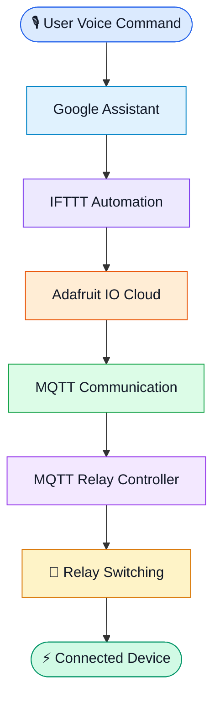
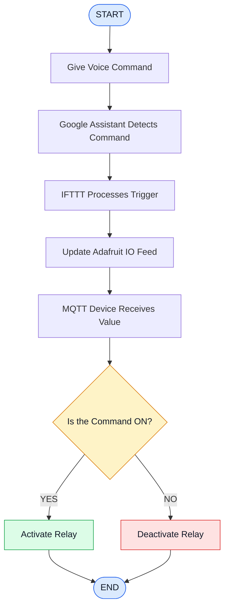

# 🎙️ Voice Control with Google Assistant & IFTTT

  <b>Task 3 – Voice Automation</b> 
  Hands-Free Control of an MQTT-Based Relay System

  
  
  
  

---

## 📌 1. Project Overview

This project introduces **voice-controlled automation** to an MQTT-based relay system using Google Assistant, IFTTT, and Adafruit IO.

The system allows users to control a connected relay through voice commands without manually operating a switch or control interface.

The voice command is detected by Google Assistant, processed through an IFTTT automation applet, and transmitted to Adafruit IO. The connected MQTT device receives the updated feed value and changes the relay state accordingly.

### 🎯 Project Objective

- Enable hands-free relay control using voice commands.
- Connect voice automation with MQTT communication.
- Use IFTTT to automate communication between services.
- Control electrical devices through a connected relay system.

---

## 🛠️ 2. Technologies Used

| Technology | Purpose |
|---|---|
| 🎙️ Google Assistant | Accepts user voice commands |
| ⚡ IFTTT | Connects voice triggers with automated actions |
| ☁️ Adafruit IO | Provides MQTT-based feed communication |
| 📡 MQTT | Transfers control messages |
| 🔌 Relay Module | Switches the connected electrical load |

---

## 🔄 3. System Architecture

The complete system follows a simple communication path:

---

## ⚙️ 4. Working Principle

The system operates through the following sequence:

| Step | Process | Description |
|:---:|---|---|
| 01 | Voice Input | User gives a supported voice command. |
| 02 | Voice Detection | Google Assistant detects the command. |
| 03 | Automation Trigger | IFTTT identifies the configured trigger. |
| 04 | Cloud Communication | IFTTT updates the corresponding Adafruit IO feed. |
| 05 | MQTT Reception | The connected device receives the updated feed value. |
| 06 | Relay Control | The relay switches according to the received command. |

### 🔁 ON/OFF Control Flowchart

---

## 🔧 5. Implementation Steps

### Step 1 – MQTT Relay Setup
- Prepare the MQTT-based relay system.
- Verify the relay ON/OFF operation independently.
- Ensure the controller can receive MQTT messages.

### Step 2 – Adafruit IO Configuration
- Create an Adafruit IO account.
- Create the required feed.
- Obtain the MQTT credentials.
- Configure the device to connect to Adafruit IO.

### Step 3 – IFTTT Configuration
- Open IFTTT.
- Create a new applet.
- Select Google Assistant as the voice trigger.
- Configure the corresponding Adafruit IO action.

### Step 4 – Device Configuration
- Connect the controller to the MQTT service.
- Subscribe to the configured feed.
- Map received feed values to relay ON and OFF operations.

### Step 5 – Testing
- Give the configured voice commands.
- Verify that IFTTT detects each command.
- Check the Adafruit IO feed updates.
- Confirm that the relay responds correctly.

---

## 🧪 6. Testing and Verification

The following checklist can be used to verify the system.

| Test No. | Testing Parameter | Expected Result | Status |
|:---:|---|---|:---:|
| 01 | MQTT relay operation | Relay works independently | ⬜ |
| 02 | Adafruit IO connection | Device connects successfully | ⬜ |
| 03 | Voice trigger detection | IFTTT detects the command | ⬜ |
| 04 | Feed update | Correct feed value is published | ⬜ |
| 05 | Relay ON command | Relay turns ON | ⬜ |
| 06 | Relay OFF command | Relay turns OFF | ⬜ |
| 07 | Repeated commands | Consistent operation | ⬜ |

---

## 🔐 7. Safety Precautions

- Initially test the relay without connecting a high-voltage load.
- Use a properly rated relay module.
- Provide suitable electrical protection.
- Disconnect the power supply before modifying circuit connections.
- Never expose MQTT passwords, Adafruit IO credentials, or API keys in public repositories.
- Store sensitive credentials securely.

---

## 📂 8. Project Information

Complete the following details according to the actual implementation.

| Parameter | Details |
|---|---|
| Project Name | Voice-Controlled MQTT Relay System |
| Controller Board | To be updated |
| Relay Module | To be updated |
| Cloud Platform | Adafruit IO |
| Communication Protocol | MQTT |
| Voice Assistant | Google Assistant |
| Automation Platform | IFTTT |
| MQTT Feed Name | To be updated |
| Supported Voice Commands | To be updated |

---

## 🏁 9. Expected Outcome

The final system enables users to control an MQTT-based relay through Google Assistant voice commands.

The integration of Google Assistant, IFTTT, and Adafruit IO creates a convenient communication pathway between voice input and physical relay operation.

**Final Workflow:**

`Voice Command → Google Assistant → IFTTT → Adafruit IO → MQTT → Relay Control`

---

## 👨‍💻 10. Project Conclusion

This project demonstrates how voice automation can be integrated with IoT-based relay control systems.

By combining Google Assistant, IFTTT, and Adafruit IO, the system provides a simple hands-free approach to controlling connected electrical devices.

It also provides practical exposure to cloud communication, MQTT protocols, and automation technologies.
