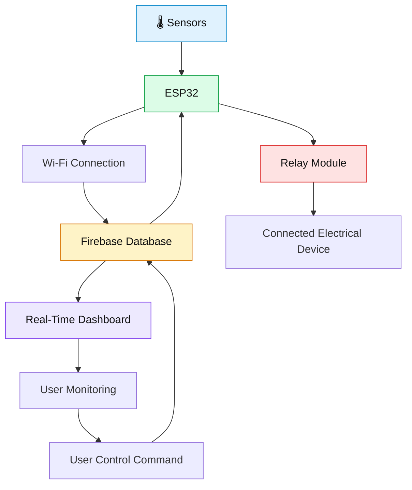
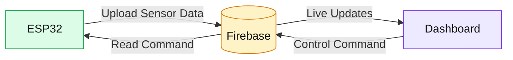
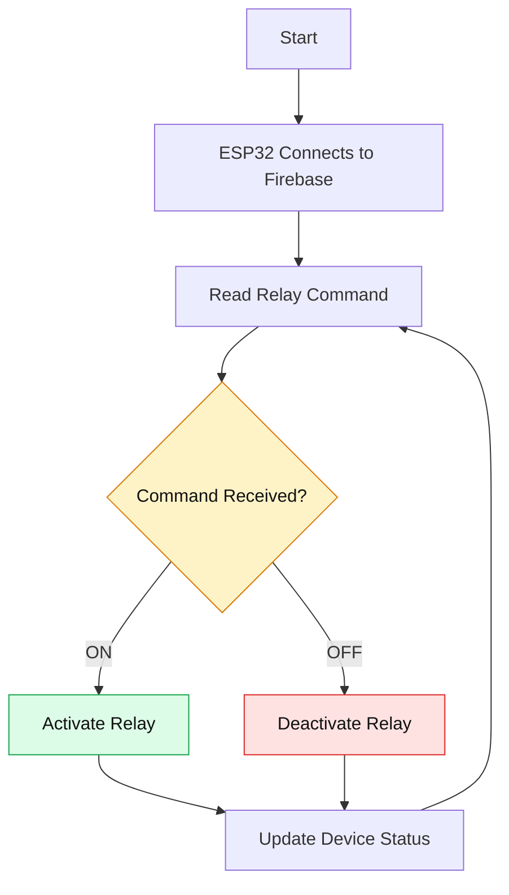

# 🏠 ESP32 Smart Home Integration

  <strong>Task 5 · Arduino Integration · IoT Project</strong>

  An IoT-based smart home system that connects sensors, Firebase, a real-time dashboard, and relay control using an ESP32.

---

## 📌 Project Overview

The **ESP32 Smart Home Integration** project demonstrates how hardware and software can work together to create a connected home automation system.

The ESP32 collects sensor readings, communicates with Firebase, and allows users to monitor data through a dashboard. The relay module can also be controlled to switch connected electrical devices ON or OFF.

### ✨ Key Features

- 📡 ESP32-based IoT communication
- 🌡️ Real-time sensor data collection
- ☁️ Firebase cloud database integration
- 📊 Live data monitoring through a dashboard
- 🔌 Relay-based device control
- 🔄 Real-time data synchronization

---

## 🔄 System Architecture

The following flowchart explains how the complete system works:

---

## ⚙️ Working Principle

The system operates through the following stages:

| Step | Component | Function |
|---|---|---|
| 01 | Sensors | Collect environmental or other sensor readings. |
| 02 | ESP32 | Reads sensor values and processes the data. |
| 03 | Wi-Fi | Connects the ESP32 to the internet. |
| 04 | Firebase | Stores and synchronizes the data. |
| 05 | Dashboard | Displays the latest sensor readings. |
| 06 | User | Monitors the system and sends control commands. |
| 07 | Relay Module | Switches the connected device ON or OFF. |

---

## ☁️ Firebase Integration

Firebase acts as the cloud communication platform between the ESP32 and the dashboard.

**Main operations:**

- Upload sensor readings from the ESP32.
- Store the latest sensor values in Firebase.
- Retrieve control commands from the database.
- Synchronize updates with the dashboard.

---

## 🔌 Relay Control Logic

The relay module is used to control an external electrical device based on the command received from Firebase.

---

## 🧰 Technologies Used

| Technology | Purpose |
|---|---|
| ESP32 | Main microcontroller |
| Arduino IDE | Programming and uploading code |
| Firebase | Cloud database and real-time communication |
| Wi-Fi | Wireless internet connectivity |
| Sensors | Collect input data |
| Relay Module | Electrical device control |
| Dashboard | Display sensor data and control devices |

---

## 🛠️ Implementation Steps

1. Connect the sensors and relay module to the ESP32.
2. Install and configure the required ESP32 board package in Arduino IDE.
3. Create and configure the Firebase project.
4. Add the Firebase connection details to the Arduino program.
5. Upload the program to the ESP32.
6. Connect the ESP32 to the Wi-Fi network.
7. Verify that sensor readings are uploaded to Firebase.
8. Connect the dashboard to Firebase.
9. Test relay control using dashboard commands.

---

## 🧪 Testing and Verification

| Test | Expected Result | Status |
|---|---|---|
| ESP32 startup | ESP32 starts successfully | ⬜ |
| Wi-Fi connection | ESP32 connects to Wi-Fi | ⬜ |
| Sensor reading | Sensor values are received | ⬜ |
| Firebase upload | Data is stored in Firebase | ⬜ |
| Dashboard update | Latest values are displayed | ⬜ |
| Relay ON command | Relay switches ON | ⬜ |
| Relay OFF command | Relay switches OFF | ⬜ |

---

## ⚠️ Safety Precautions

- Check all wiring before powering the circuit.
- Use the correct operating voltage for each component.
- Do not connect high-voltage appliances directly to ESP32 GPIO pins.
- Use a properly rated relay module and suitable electrical protection.
- Test the relay using a low-voltage load before connecting mains-powered equipment.
- Keep electrical connections properly insulated.

---

## 🎯 Expected Outcome

At the end of this task, the ESP32, sensors, Firebase, dashboard, and relay module should work together as one connected IoT system.

The user should be able to monitor sensor readings in real time and control a connected device through the dashboard.

---

## 👨‍💻 Project Information

| Detail | Information |
|---|---|
| Project | ESP32 Smart Home Integration |
| Task | Task 5 – Arduino Integration |
| Platform | ESP32 |
| Cloud Platform | Firebase |
| Programming Environment | Arduino IDE |
| Project Domain | Internet of Things (IoT) |

---

  <strong>🏠 Smart Monitoring · ☁️ Cloud Integration · 🔌 Automation</strong>
   
  Task 5 – ESP32 Smart Home Integration

